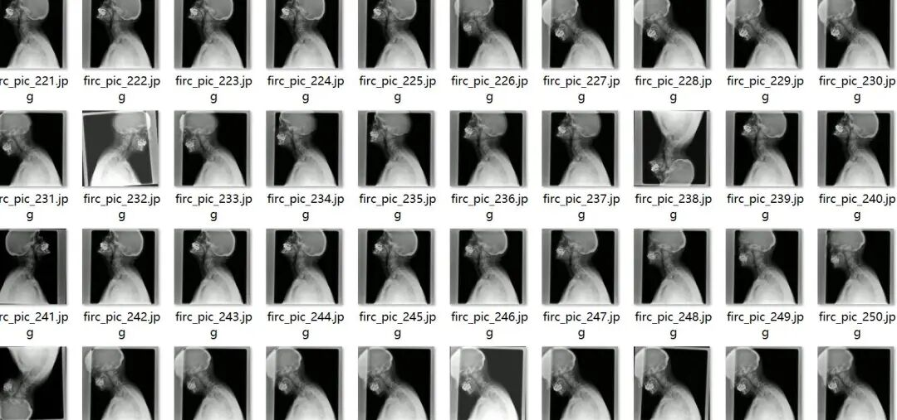
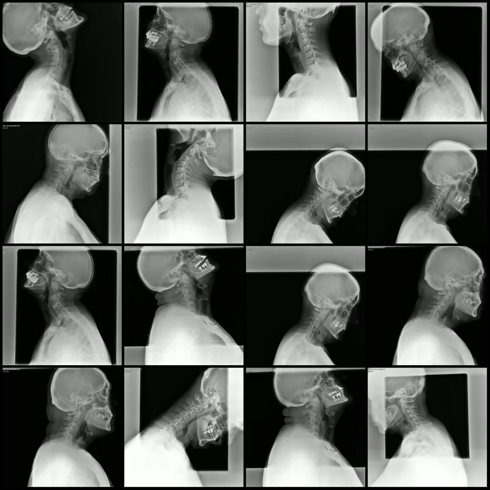
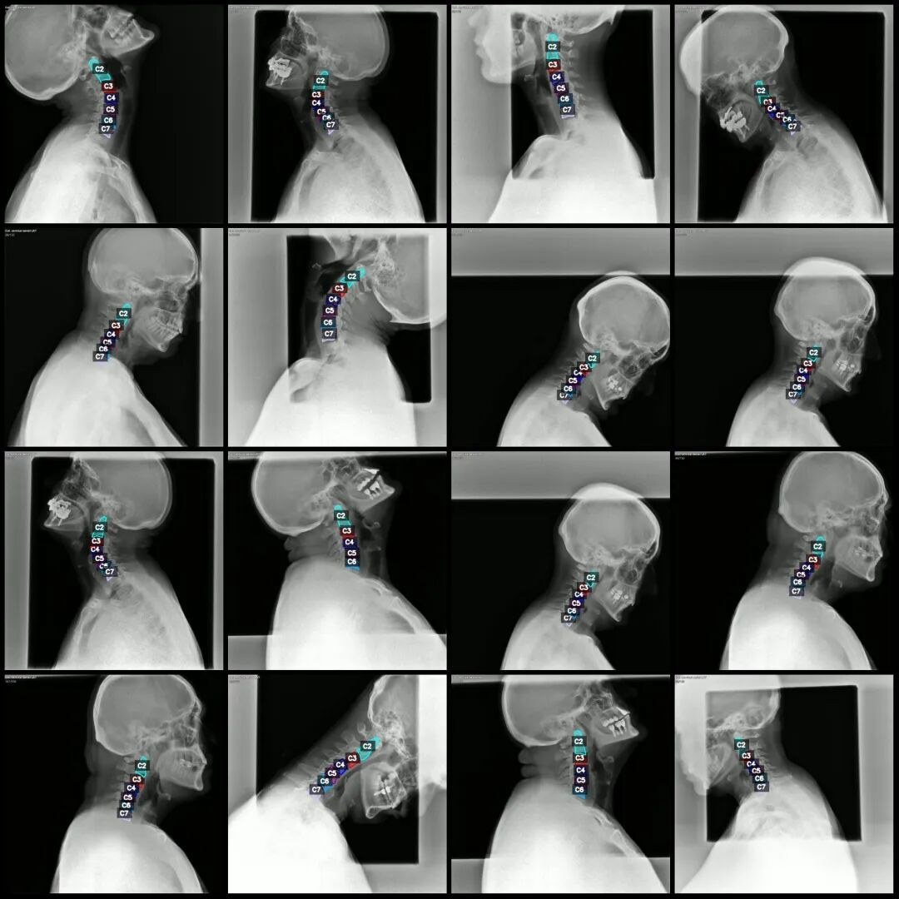
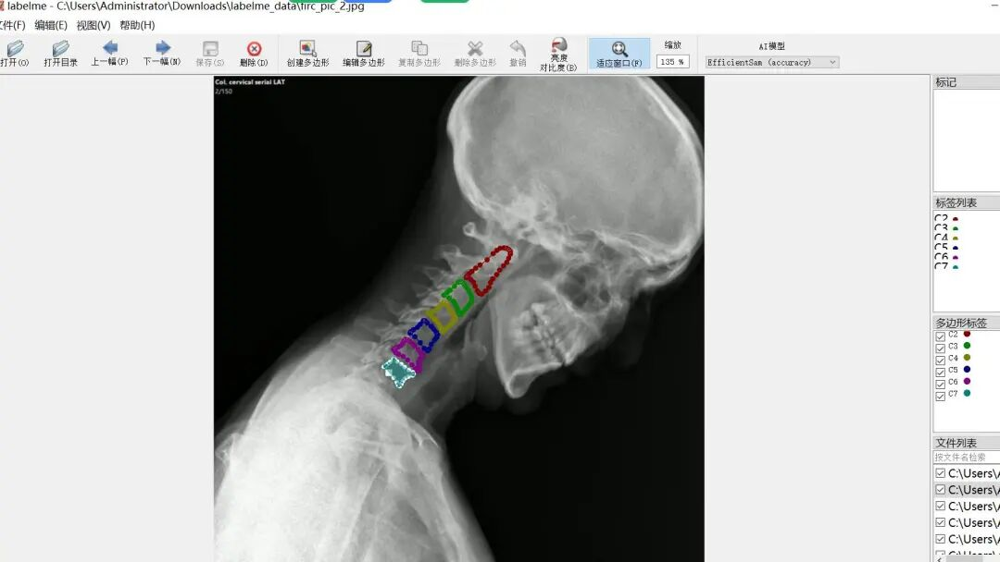

# Intelligent Medical Cervical Spine Vertebra Segmentation Dataset in LabelMe format with 1054 images across 6 categories

Dataset format: labelme format (without mask files, only including jpg images and corresponding json files)

Number of images (number of jpg files): 1054

Number of annotations (number of json files): 1054

Label count: 6

Annotation category names: ["C2", "C3", "C4", "C5", "C6", "C7"]

Number of boxes labeled in each category:

C2 count = 1067

C3 count = 1054

C4 count = 1054

C5 count = 1052

C6 count = 1040

C7 count = 965

Total frame count: 6232

Using labeling tool: labelme=5.5.0

Image resolution: 640x640

Annotation rules: Draw polygons around the categories.

Important Notice: The dataset can be opened and edited using LabelMe. For JSON datasets, one must convert them into mask or Yolo formats for semantic segmentation or instance segmentation.

Special : This dataset does not guarantee the accuracy of the trained models or weight files.

Image Preview:

Annotation example:

Original image (pick 16 randomly):

Annotation:

LabelMe editing example:

## Payment

Here is a pay link on Stripe ( https://buy.stripe.com/3cs8yP7sY87d0vu9AB ). Please contact me lonlonago@foxmail.com after funding $89, and I will send you a complete data files , thank you!

